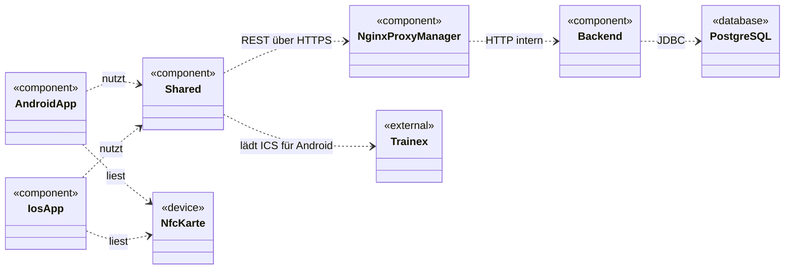
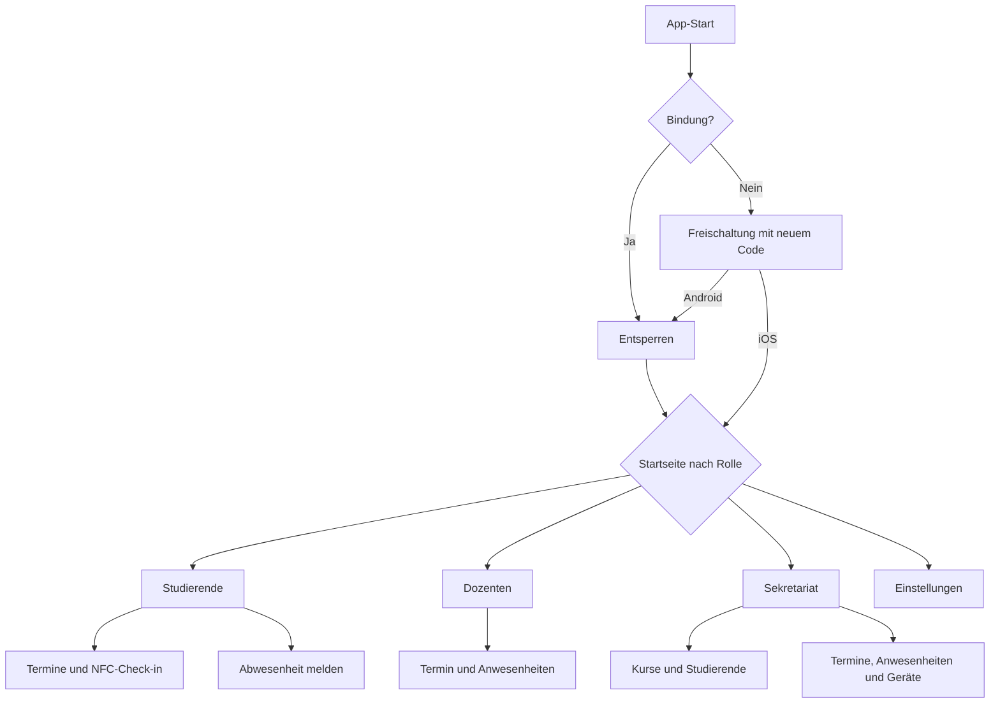
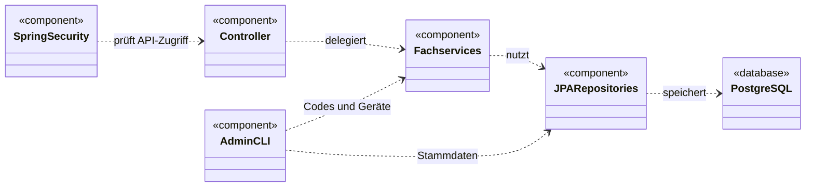

# Technische Dokumentation: BA Check-in

| Feld | Wert |
|---|---|
| Dokumentenart | Technische Dokumentation |
| Projekt | BA Check-in |
| Stand | 24.09.2026 |
| Version | v1.0 |

## 1. Steckbrief zum System

BA Check-in verwaltet Kurse, Termine, Abwesenheiten und Anwesenheiten. Studierende
können sich mit einer NFC-Karte für einen passenden Termin einchecken. Dozenten
bearbeiten Anwesenheiten. Das Sekretariat verwaltet Benutzer, Termine und
Geräte. Das Projekt besteht aus einer Android-App, einer iOS-App, gemeinsamem
Kotlin-Code und einem Spring-Backend mit PostgreSQL. Grundlage sind die
[Projektübersicht](../README.md) und die [API-Übersicht](api.md).

## 2. Architektur und Umgebungen

### 2.1 Systemkontext und Systemabgrenzung

Das vereinfachte UML-Komponentendiagramm zeigt die Apps, den gemeinsamen
Kotlin-Code, das Backend, die Infrastruktur und die externen Schnittstellen.



In der Produktion laufen die Backend-Anfragen über Nginx Proxy Manager. In der
lokalen Entwicklung können die Apps das Backend direkt erreichen.

| Partner | Schnittstelle | Verbindung | Verantwortung |
|---|---|---|---|
| Android und iOS | `/api/v1/**` | HTTPS an `bacheckin.brettspielrunde.com` über den Proxy; Backend intern auf Port 8080 | App sendet Anfragen, Backend prüft und speichert Daten |
| NFC-Karte | NDEF mit SDM-Daten | NFC am Mobilgerät | Karte liefert Daten für den Check-in |
| Trainex-Kalender | ICS-Datei | Import durch das Sekretariat über die API | Liefert Kurs- und Termindaten |
| PostgreSQL | JDBC | Intern auf Port 5432 | Speichert Benutzer, Geräte, Termine und Anwesenheiten |

Die Produktions-Compose-Datei veröffentlicht keinen Datenbank- oder
Backend-Port am Host. Das Backend ist im Docker-Netz `npm_proxy` erreichbar.
Eine genaue Firewall-Freigabeliste ist im Repository nicht dokumentiert.
Quellen: [Produktions-Compose](../compose.production.yml),
[Android-Konfiguration](../composeApp/build.gradle.kts),
[iOS-Konfiguration](../iosApp/iosApp/Feature/Login/Storage/BackendSession.swift),
[Kalenderimport](../backend/src/main/java/de/ba/check/in/application/controller/TrainexCalendarImportController.java).

### 2.2 Bausteinsicht

| Baustein | Aufgabe | Technik |
|---|---|---|
| [composeApp](../composeApp) | Android-Oberfläche und NFC-Lesen | Kotlin, Compose, Android SDK |
| [iosApp](../iosApp) | iOS-Oberfläche und NFC-Lesen | SwiftUI, CoreNFC |
| [shared](../shared) | Datenmodelle und HTTP-Anbindung beider Apps | Kotlin Multiplatform, Ktor |
| [backend](../backend) | REST-API, Authentifizierung und Fachlogik | Spring Boot, Java 21 |
| [Datenbankschema](../backend/src/main/resources/db/migration) | Tabellen und Schemaänderungen | PostgreSQL, Flyway |

### 2.3 Frontend

Das Frontend besteht aus zwei Apps: [`composeApp`](../composeApp/src/androidMain/kotlin/de/jscoding/bacheckin/feature)
stellt die Android-Oberfläche mit Compose bereit, [`iosApp`](../iosApp/iosApp/Feature)
die iOS-Oberfläche mit SwiftUI. Beide Apps führen durch Freischaltung und
Entsperrung, zeigen rollenabhängige Ansichten für Studierende, Dozenten und
Sekretariat und lesen NFC-Karten über die jeweilige Plattform-API.

Beide Apps nutzen [`shared`](../shared/src/commonMain/kotlin/de/jscoding/bacheckin/shared)
für gemeinsame Datenmodelle, API-Verträge und die Backend-Anbindung. Dessen
`BackendRemoteDataSourceImpl` wählt für die Android-Demo ein Backend im App-Prozess
und für den regulären Betrieb die REST-API. Die Android-App lädt außerdem
Trainex-Kalenderdaten und sendet die ICS-Inhalte zum Import an das Backend.

#### 2.3.1 Screen-Struktur

Die Übersicht fasst die wichtigsten Ansichten beider Apps zusammen. Die
rollenabhängigen Bereiche enthalten weitere Detailansichten und Dialoge. Die
zusätzlichen Android-Funktionen des Sekretariats stehen in der
[Bedienanleitung](Bedienanleitung.md). Beim App-Start führt eine vorhandene
Gerätebindung auf beiden Plattformen zur Entsperrung. Ohne Bindung ist ein
neuer Freischaltcode nötig. Die beiden Entsperr-Knoten zeigen denselben Screen
auf unterschiedlichen Wegen.



Quellen: [Android-Navigation](../composeApp/src/androidMain/kotlin/de/jscoding/bacheckin/navigation/AppNavHost.kt),
[iOS-Start](../iosApp/iosApp/Feature/Login/AppStartView.swift) und
[iOS-Rollenansichten](../iosApp/iosApp/Feature/HomeScreen/HomeContainerView.swift).

### 2.4 Backend

Das [Spring-Backend](../backend/src/main/java/de/ba/check/in) stellt die
REST-API unter `/api/v1` bereit. Sie umfasst Geräteaktivierung und Anmeldung,
rollenbezogene App-Daten, Kurs- und Terminverwaltung, Abwesenheiten,
Anwesenheiten, Kalenderimport und NFC-Check-in. Geschützte Zugriffe werden
anhand von Rolle, JWT und aktiver Gerätebindung geprüft.

Controller nehmen Anfragen an, Services prüfen die Fachregeln und Repositories
lesen oder schreiben PostgreSQL-Daten. Flyway verwaltet das
[Datenbankschema](../backend/src/main/resources/db/migration); der
[`AdminCommandRunner`](../backend/src/main/java/de/ba/check/in/admin/AdminCommandRunner.java)
stellt serverseitige Verwaltungsbefehle bereit. Beim NFC-Check-in prüft der
[`NfcCheckInService`](../backend/src/main/java/de/ba/check/in/nfc/service/NfcCheckInService.java)
Karte, Lesezähler und passenden Termin, bevor er die Anwesenheit speichert.

#### 2.4.1 Interne UML-Komponentensicht

Die Übersicht zeigt den Weg einer API-Anfrage durch das Backend und den
separaten Einstieg für serverseitige Admin-Befehle.



Beispiele: [Sicherheitskonfiguration](../backend/src/main/java/de/ba/check/in/auth/security/config/SecurityConfig.java),
[App-Controller](../backend/src/main/java/de/ba/check/in/application/controller/StudentController.java),
[Fachservice](../backend/src/main/java/de/ba/check/in/application/service/ApplicationFlowService.java)
und [Repository](../backend/src/main/java/de/ba/check/in/students/repository/StudentRepository.java).

## 3. Konzepte

### 3.1 Sicherheitsanforderungen

| Anforderung | Maßnahme | Status |
|---|---|---|
| Nur aktivierte Geräte dürfen geschützte Daten abrufen | Gerätebindung, JWT und Prüfung des Geräte-Status bei jedem Request | Umgesetzt |
| Codes und Sitzungen dürfen nicht beliebig oft verwendet werden | Befristete Challenges, einmalige Codes, rotierende Refresh-Token und Anfragelimits | Umgesetzt |
| NFC-Nachrichten dürfen nicht wiederverwendet werden | Kryptografische Prüfung und gespeicherter Lesezähler | Umgesetzt |
| Access-Token sollen nach fünf Minuten ablaufen | Gültigkeit `PT5M` in der [Sicherheitskonfiguration](../backend/src/main/resources/application.yml) | Umgesetzt |
| Refresh-Token sollen nach sieben Tagen Inaktivität und spätestens nach 30 Tagen ablaufen | Fristen `P7D` und `P30D` in der [Sicherheitskonfiguration](../backend/src/main/resources/application.yml) | Umgesetzt |
| JWT- und NFC-Schlüssel sollen dem Backend als Dateien bereitgestellt werden | Die [Produktions-Compose-Datei](../compose.production.yml) bindet die Schlüsseldateien schreibgeschützt ein | Umgesetzt |
| Ein Gerätewechsel oder eine Sperrung soll die alte Bindung ungültig machen | Der [Gerätefilter](../backend/src/main/java/de/ba/check/in/auth/security/filter/ActiveDeviceFilter.java) prüft die aktive Bindung bei jedem Request | Umgesetzt |

### 3.2 Benutzerkonzept

| Rolle | Funktionen | Zusätzliche Prüfung |
|---|---|---|
| `STUDENT` | Termine und Abwesenheiten sehen, Abwesenheit melden, NFC-Check-in | Eigene Benutzer-ID und aktives Gerät |
| `LECTURER` | Eigene Termine öffnen, Anwesenheiten bearbeiten | Zuordnung zum Termin |
| `SECRETARY` | Kurse, Termine, Benutzer und Geräte verwalten | Sekretariatsrolle im Token |

Die Rolle steht am Benutzerkonto und wird im JWT mitgegeben. Die API prüft die
Rolle sowie Benutzer, Gerät und Sitzungsstand. Eine Superuser-Rolle gibt es im
[Backend-Rollenmodell](../backend/src/main/java/de/ba/check/in/users/domain/UserRole.java)
nicht. Neue Konten und Aktivierungscodes können mit den
[Admin-Befehlen](admin-management.md) angelegt werden.

### 3.3 Testkonzept

Im aktuellen Repository sind keine automatisierten Testdateien oder
Coverage-Berichte zu finden. Der [GitHub-Workflow](../.github/workflows/backend-image.yml)
baut und veröffentlicht das Backend-Image; ein Testschritt ist dort nicht
definiert. Die [Projekt-README](../README.md) beschreibt einen Demo-Build im
Android-Emulator und weist darauf hin, dass echte NFC-Scans ein Android-Gerät
brauchen. Für iOS- und Backend-Testabdeckung gilt: Keine Informationen im
Repository gefunden.

### 3.4 Monitoring und Logging

| Quelle | Was sichtbar ist |
|---|---|
| `docker compose ps` | Containerstatus und PostgreSQL-Healthcheck |
| `docker compose logs backend` | Backend-Logs |
| API-Fehler | Fehlercode und `traceId` in der Antwort |
| `audit_logs` | Sicherheitsereignisse wie Aktivierung und Gerätesperrung |

Quellen: [Admin-Befehle](admin-management.md),
[Fehlerbehandlung](../backend/src/main/java/de/ba/check/in/api/error/GlobalExceptionHandler.java),
[Audit-Service](../backend/src/main/java/de/ba/check/in/audit/service/SecurityAuditService.java).
Ein HTTP-Health-Endpunkt, Dashboards, Alarme und Metrik-Schwellwerte sind im
Repository nicht konfiguriert.

## 4. Anleitungen

### 4.1 Onboarding

| Werkzeug | Belegter Stand | Wofür |
|---|---|---|
| Java | 21 | Backend und Gradle-Build |
| Gradle | Wrapper 9.5.1 | Projekt bauen |
| Docker Compose | Version nicht festgelegt | PostgreSQL und Produktionscontainer starten |
| Android SDK | Version über [Build-Konfiguration](../composeApp/build.gradle.kts) | Android-App bauen |
| Xcode | Version nicht festgelegt | iOS-App bauen |

Der schnellste Einstieg ist die Demo im Android-Emulator:

```bash
cp secrets.json.example secrets.json
./gradlew :composeApp:installFakeDebug
```

Für ein lokales Backend mit PostgreSQL und für iOS stehen die Schritte in der
[Projekt-README](../README.md). Code liegt in `composeApp`, `iosApp`, `shared`
und `backend`. Konfiguration liegt in den Compose-Dateien und unter
`backend/src/main/resources`. Eine Backup-Ablage ist nicht dokumentiert.

### 4.2 Deployment

Der [Workflow](../.github/workflows/backend-image.yml) baut bei einem Push auf
`main` das Backend-JAR und veröffentlicht ein Container-Image in der GitHub Container
Registry. Auf dem Server verwendet [Docker Compose](../compose.production.yml)
dieses Image. Vor dem Start müssen die Werte aus
[`.env.production.example`](../.env.production.example) und die JWT- und
NFC-Schlüsseldateien bereitliegen.

Die folgenden Befehle laufen auf dem Server in `/srv/bacheckin` mit
`DOCKER_CONFIG=/srv/bacheckin/docker-config`:

```bash
cd /srv/bacheckin
export DOCKER_CONFIG=/srv/bacheckin/docker-config
docker compose --env-file .env.production -f compose.production.yml pull backend
docker compose --env-file .env.production -f compose.production.yml up -d --no-deps --force-recreate backend
docker compose --env-file .env.production -f compose.production.yml ps
docker compose --env-file .env.production -f compose.production.yml logs --tail=100 backend
```

Der Datenbankcontainer muss `healthy` sein und das Backend ohne Startfehler
laufen. Die Schritte sind auch in [admin-management.md](admin-management.md)
aufgeführt. Ein vollständiges Backup-, Datenbank-Rollback- und
Deinstallationsverfahren ist im Repository nicht dokumentiert.

### 4.3 Monitoring und Störungen

Für die erste Prüfung dienen `docker compose ps` und die Backend-Logs.
API-Fehler liefern einen `traceId`, mit dem sich der Fehler in Logs zuordnen
lässt. Bei einem fehlgeschlagenen NFC-Check-in sind Kartenstatus,
Gerätebindung und Terminberechtigung die Prüfstellen im
[Check-in-Service](../backend/src/main/java/de/ba/check/in/nfc/service/NfcCheckInService.java).
Ein erreichbarer HTTP-Healthcheck und ein Eskalationsweg sind nicht dokumentiert.

## 5. Prozesse

Der technische Ablauf für Aktivierung, Anmeldung und NFC-Check-in ergibt sich
aus den Kapiteln 2 und 3. Organisatorische Freigaben, Rufbereitschaft und
Eskalationszeiten: Keine Informationen im Repository gefunden.
